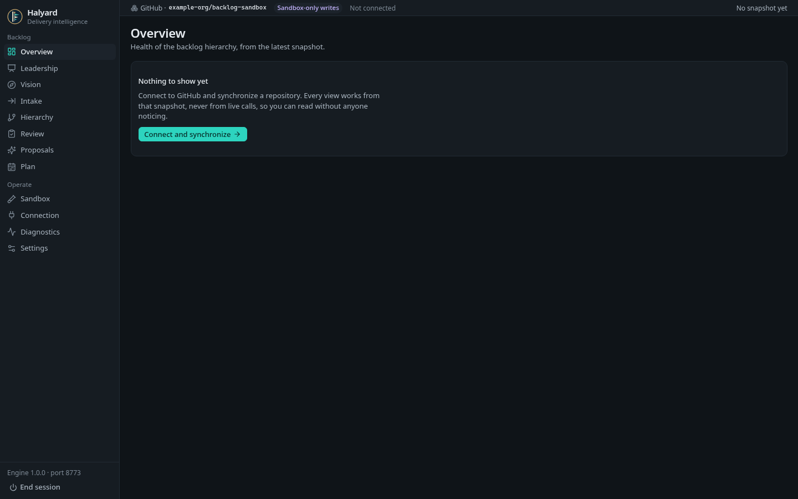
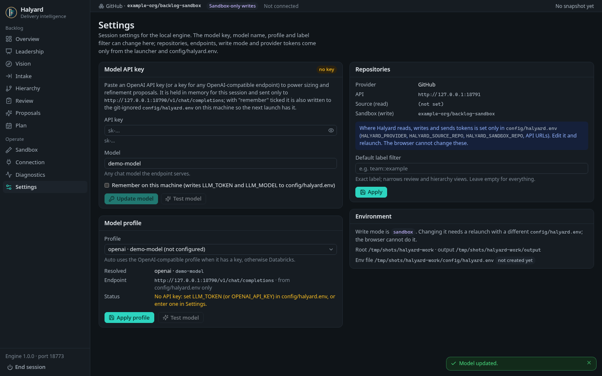
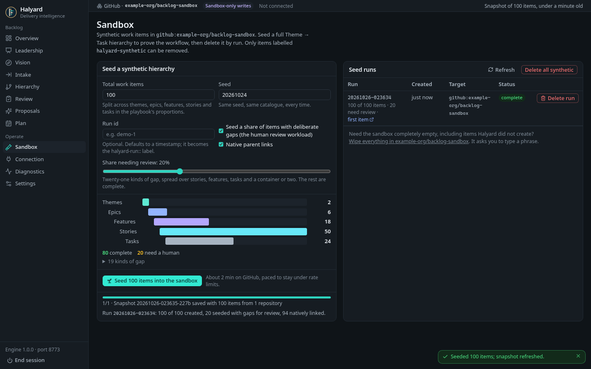
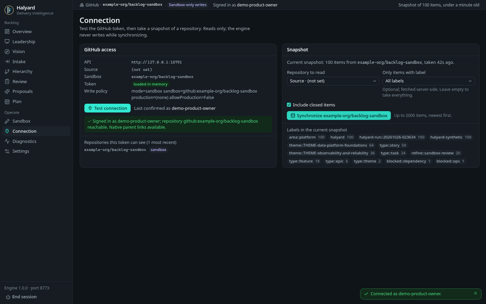
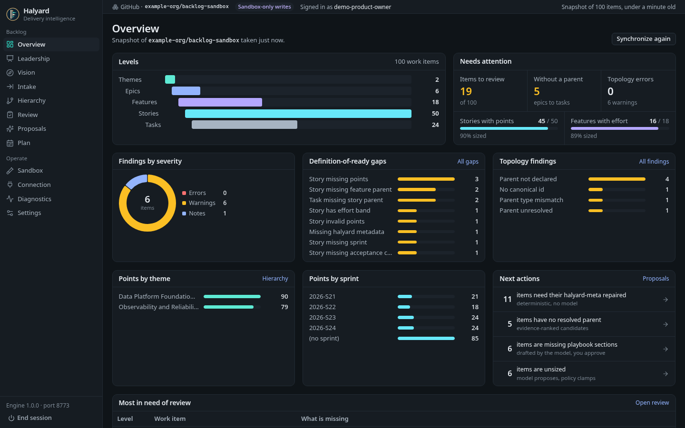
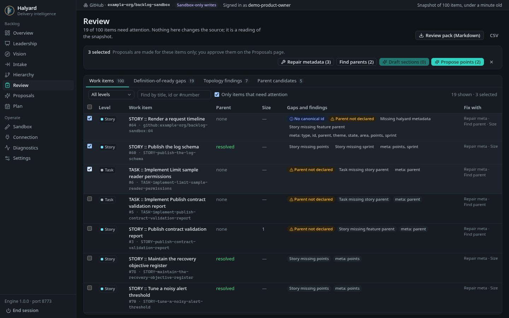
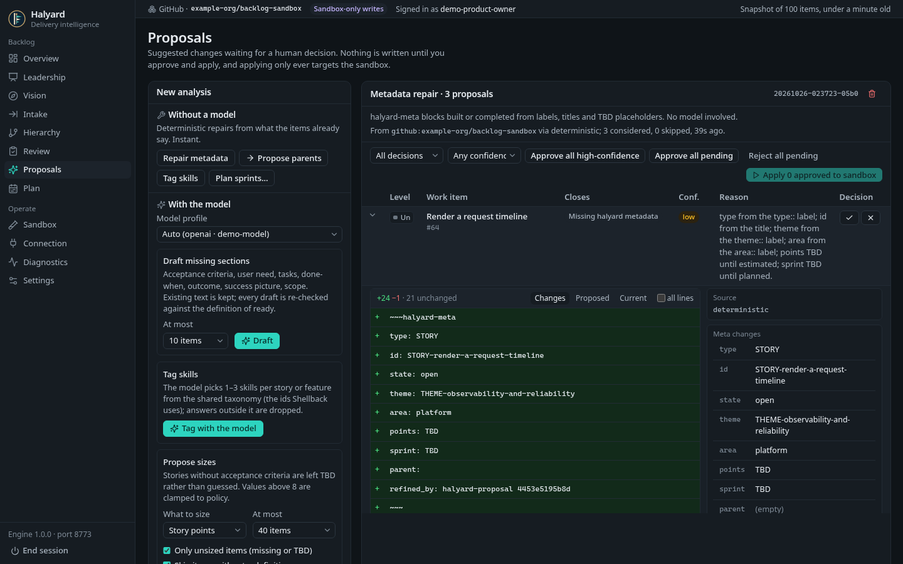

# Halyard walkthrough

Seed a synthetic backlog, find its gaps, and approve the fixes Halyard proposes, without touching a real repository.

> **Screenshots:** captured with demo data and scanned by the Chief of Staff (team directive 10).

## Before you start

- Windows PowerShell 5.1 (part of Windows). No administrator rights and no installer.
- Microsoft Edge or Google Chrome.
- Launch: `build\Build-Halyard.ps1` once on the build machine, then `.\Launch-Halyard.bat` (opens the browser UI on `127.0.0.1`).
- A sandbox repository you are allowed to write to (the walkthrough uses a synthetic one).

## Steps

### 1. First launch

Halyard opens on **Overview**. With nothing synchronized yet it says *Nothing to show yet* and offers **Connect and synchronize**. The sidebar lists the Backlog and Operate pages.

### 2. Set up the model

Open **Settings**, enter the model name and your API key, and select **Test**. The key is held in memory unless you tick *remember*.

### 3. Seed the sandbox

Open **Sandbox** and seed 100 synthetic items. About 80 are complete and 20 carry a gap.

### 4. Synchronize

Open **Connection**, test the token and synchronize the sandbox.

### 5. Read the overview

Back on **Overview**, see the hierarchy levels, items needing review, sizing coverage and next actions.

### 6. Review the gaps

Open **Review**. Every item is checked against its definition of ready. Select rows to use the bulk bar.

### 7. Approve a proposal

Open **Proposals**, open a row to read its before and after diff, and approve it with the check-mark button. Then select **Apply approved to sandbox**. Delete the run from **Sandbox** when you are done.

## About these images

Images live in [`docs/assets/walkthrough/`](../assets/walkthrough/), named `NN-<screen>.png` after the step they belong to. They are 1440x900 at 100% scale in the Night watch (dark) theme, and show demo data only.
